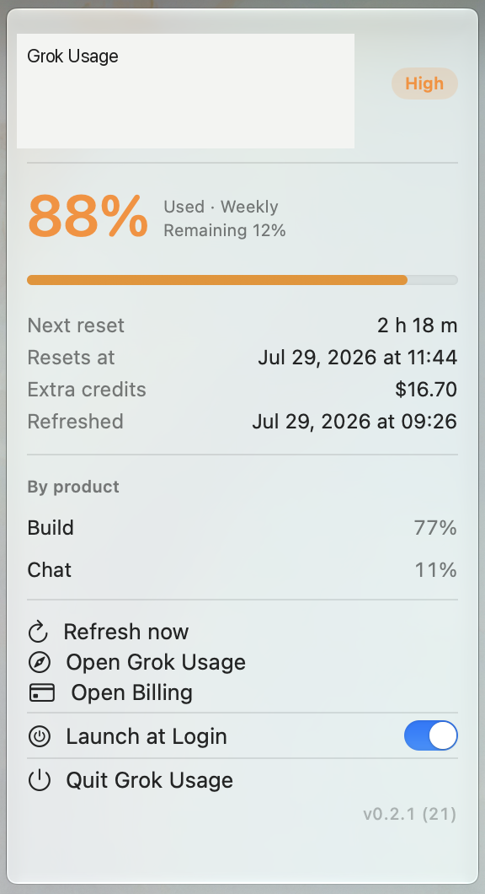

# Grok Usage

**[English](README.md)** | **简体中文**

轻量 macOS 菜单栏应用：显示 **SuperGrok 周用量**、**Grok Bot 周用量**（独立配额）与 **下次重置倒计时**。

<p align="center">
  
  
  
</p>

> **非官方项目。** 使用与 Grok Build CLI 相同的本地登录态与额度元数据接口，xAI 变更时可能失效。

## 功能

- **菜单栏图标** — 仅 SF Symbol；悬停可看简短用量摘要
- **下拉详情** — SuperGrok 进度、产品占比、额外额度，以及独立的 Grok Bot 周用量
- **浏览器登录** — SuperGrok 走 xAI 设备码；Bot 走 Cursor PKCE（也可沿用本机 Grok Bot）
- **后台刷新** — 清醒时约每 20 分钟；睡眠时不请求
- **阈值告警** — 20 / 40 / 60 / 80 / 90 / 95 / 98% 每档每周期一次（SuperGrok 与 Bot 各自独立）
- **登录时启动**
- **自动续期 token** — 尽量自动续期 OIDC / Bot（一般不必每天重新登录）
- **语言** — 跟随 macOS（英/简中），支持「为 App 单独设置语言」

## 截图

<p align="center">
  
</p>

## 安装

### 下载（推荐）

从 [Releases](https://github.com/kDolphin/grok-usage/releases) 下载最新 `GrokUsage.zip`：

1. 解压
2. 将 `Grok Usage.app` 拖入 `/Applications`
3. 首次启动：右键 → **打开**（未公证签名）

### 从源码构建

```bash
git clone https://github.com/kDolphin/grok-usage.git
cd grok-usage
bash build.sh
open "build/Grok Usage.app"
```

安装：

```bash
cp -R "build/Grok Usage.app" /Applications/
```

## 系统要求

- macOS 13 或更高
- 有 xAI / Grok 账号（在 App 里点 **浏览器登录** 即可，不必安装 Grok Build CLI）
- 可选：已用 [Grok Build](https://x.ai/build) CLI 登录也可以（共用 `~/.grok/auth.json`）
- Bot 用量可选：点 **浏览器登录 Bot**（Cursor PKCE，token 存本应用钥匙串），或沿用本机 [Grok Bot](https://grok.com/bot) 登录

## 使用

1. 打开 **Grok Usage**，菜单栏出现状态。
2. 点击查看详情与操作。
3. 需要开机启动时打开 **登录时启动**。
4. 允许通知以接收阈值告警。

## 隐私

| 行为 | 说明 |
|------|------|
| 读取 | `~/.grok/auth.json`（与 Grok Build 共用）；可选本机 Grok Bot 密钥作 Bot 后备 |
| 写入 | 可能更新 `auth.json`；Bot 浏览器登录会把 Cursor token 写入本应用钥匙串 |
| 网络 | `auth.x.ai`、`cli-chat-proxy.grok.com`（SuperGrok）、`cursor.com` / `api2.cursor.sh`（Bot 登录与用量） |
| 不上传 | 代码、会话、工程文件 |

不调用大模型，只读额度元数据。

## 故障排查

| 现象 | 处理 |
|------|------|
| SuperGrok 未登录 | 点 **浏览器登录**，或运行一次 `grok` / `grok login` |
| 无 Bot 用量 | 点 **浏览器登录 Bot**，或先打开一次 Grok Bot |
| 续期失败 | 在 App 内重新登录（SuperGrok 也可再运行一次 `grok`） |
| 无通知 | 系统设置 → 通知 → Grok Usage |
| 开机启动失败 | 使用 `/Applications` 中的副本并在登录项中允许 |
| 无法切换语言 | 使用 `bash build.sh` 构建的版本（含 en / zh-Hans） |

## 技术栈

- Swift / SwiftUI + AppKit `NSStatusItem` / `NSPopover`（与 PowerTop 同方案）
- 无第三方依赖

## 目录结构

```text
GrokUsage/                 # 应用本体（源码 + 本地化 + 图标）
  *.swift
  Info.plist
  en.lproj/  zh-Hans.lproj/
  Resources/AppIcon.icns
build.sh                   # → build/Grok Usage.app + GrokUsage.zip
screenshot/                # README 截图
```

## License

[MIT](LICENSE)
